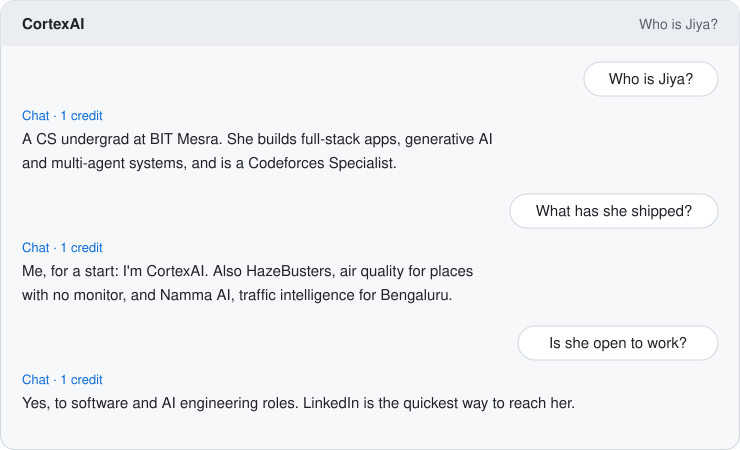
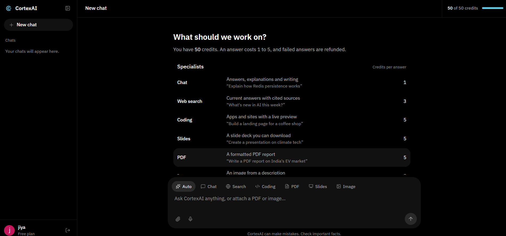
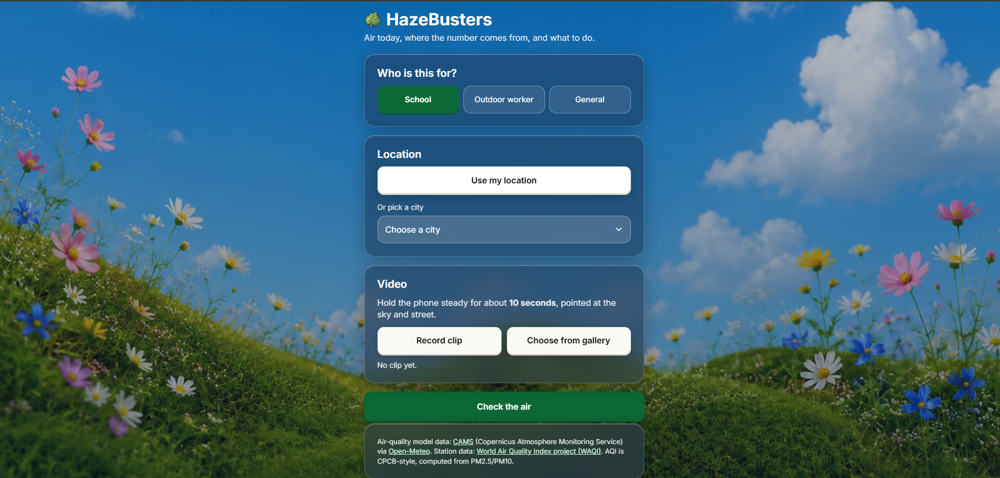
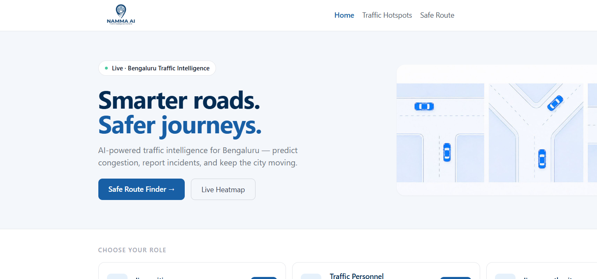

<a href="https://cortex-gateway-720170616128.asia-south1.run.app/">
<picture>
<source media="(prefers-color-scheme: dark)" srcset="assets/chat-dark.svg" />

</picture>
</a>

That's <a href="https://github.com/Jiyare06/cortex-ai">CortexAI</a>, an assistant I built. You can <a href="https://cortex-gateway-720170616128.asia-south1.run.app/">ask it something yourself</a>.

[LinkedIn](https://www.linkedin.com/in/jiya-rajeev-kumar-bba37335a) · [LeetCode](https://leetcode.com/u/AhDTEhy2fo/) · [Codeforces](https://codeforces.com/profile/shreyansh_singh) · [GeeksforGeeks](https://www.geeksforgeeks.org/profile/jiya010wxtj?tab=activity) · [Email](mailto:jiya01032006@gmail.com)

**Live:** [CortexAI](https://cortex-gateway-720170616128.asia-south1.run.app/) · [HazeBusters](https://main.dxwuap9t49si3.amplifyapp.com) · [Namma AI](https://namma-traffic-virid.vercel.app)

### 🚀 Featured projects

<table>
<tr>
<td width="50%" valign="top">

#### 🧠 [CortexAI](https://github.com/Jiyare06/cortex-ai) · [live](https://cortex-gateway-720170616128.asia-south1.run.app/)
A multi-agent AI assistant. One chat box routes each message to the right specialist: chat, cited web search, coding with live preview, PDF Q&A (RAG), and PDF / slide / image generation.

**LangGraph + LangChain** agents with tool calling and streaming responses, **RAG** over uploaded documents with Qdrant, Redis caching, JWT auth, Dockerised microservices.

`React` `Redux Toolkit` `Node.js` `MongoDB` `LangGraph` `LangChain` `Qdrant` `Redis` `Docker`

</td>
<td width="50%" valign="top">

#### 🌫️ [HazeBusters](https://github.com/Jiyare06/aqi) · [live](https://main.dxwuap9t49si3.amplifyapp.com) · [demo video](https://youtu.be/rxz5jJ9uge0)
Air quality for places with no monitor nearby: a CPCB-style AQI with its source and a confidence level, a go / limit / no outdoor decision for schools and workers, and advice in English and Hindi with audio.

Built at **WeMakeDevs × AWS Environmental Hacks 2026**. Serverless on AWS: a 10-second clip in, a decision back in about 10 seconds.

`Python` `AWS Lambda` `API Gateway` `Bedrock` `Polly` `DynamoDB` `S3` `Amplify`

</td>
</tr>
<tr>
<td width="50%" valign="top">

#### 🚦 [Namma AI](https://github.com/Jiyare06/nammaAI) · [live](https://namma-traffic-virid.vercel.app)
Traffic intelligence for Bengaluru: predict congestion, report incidents, find a safer route and see live hotspots on a heatmap, with views for commuters, traffic personnel and authorities.

**XGBoost + CatBoost ensemble** (76.2% accuracy, AUC 0.83) with SHAP explanations, DBSCAN hotspot detection and Gemini recommendations. JWT + RBAC, Redis caching, WebSockets.

`React` `FastAPI` `PostgreSQL` `Redis` `XGBoost` `CatBoost` `SHAP` `Gemini`

</td>
<td width="50%" valign="top">

#### ✍️ [BlogIt](https://github.com/Jiyare06?tab=repositories)
A blogging platform where admins run the publishing flow. Give it a topic and Gemini drafts the post; comments go through approval before they show up.

Includes **analytics and moderation dashboards**, JWT auth and ImageKit image optimisation.

`React` `Node.js` `Express` `MongoDB` `Gemini` `ImageKit`

</td>
</tr>
</table>

<source media="(prefers-color-scheme: dark)" srcset="https://raw.githubusercontent.com/Jiyare06/Jiyare06/output/github-snake-dark.svg" />

</picture>
